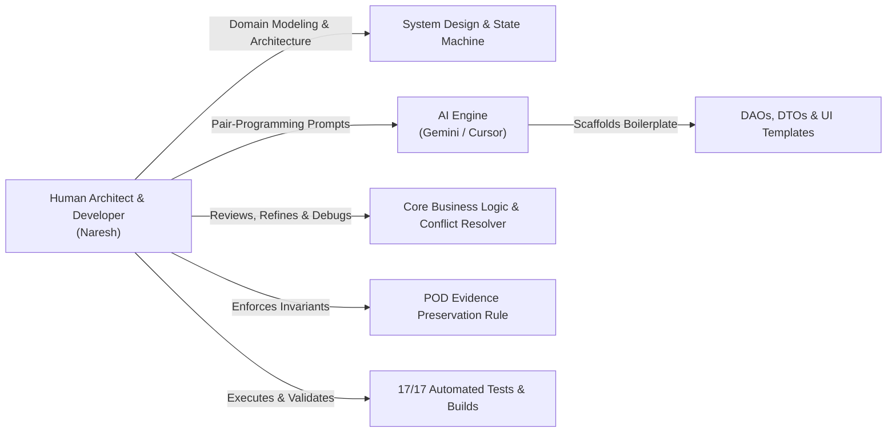

# LogiFlow — Intelligent 3PL Logistics & Proof-of-Delivery Platform

[](https://logiflow-app-theta.vercel.app/)
[](https://github.com/Naresh63-hub/logiflow)
[](https://flutter.dev)
[](https://dart.dev)
[](https://supabase.com)
[](https://drift.simonbinder.eu)
[](https://github.com/Naresh63-hub/logiflow/tree/main/test)

A production-quality, **offline-first** cross-platform Third-Party Logistics (3PL) shipment tracking and Proof-of-Delivery (POD) system built in Flutter. Engineered specifically for regional courier and freight operations across **Noida and the Delhi-NCR distribution corridor** (Noida Sector 62 Central Hub, Greater Noida West Fulfillment Hub, and Okhla Gateway Center).

---

## 🌐 Live Demos & Deliverables

| Deliverable | Location / URL | Description |
| :--- | :--- | :--- |
| **Live Web App** | [logiflow-app-theta.vercel.app](https://logiflow-app-theta.vercel.app/) | Deployed on Vercel with Drift SQLite WASM web workers & SPA routing |
| **GitHub Repository** | [github.com/Naresh63-hub/logiflow](https://github.com/Naresh63-hub/logiflow) | Full source code, test suites, database migrations & CI scripts |
| **Technical Project Report** | [`docs/LogiFlow_Project_Report.docx`](docs/LogiFlow_Project_Report.docx) | Comprehensive 8-section technical report (Word `.docx`) |
| **Architecture Specification** | [`docs/ARCHITECTURE.md`](docs/ARCHITECTURE.md) | Flowcharts, sequence diagrams, and conflict resolution rules |
| **Release APKs** | `build/app/outputs/flutter-apk/` | Signed release APKs (< 30 MB: arm64-v8a 28.1 MB, armeabi-v7a 24.3 MB) |

---

## 🧑‍💻 Engineering Methodology: Human Craftsmanship + AI Acceleration

This project was architected and developed by **Naresh** ([@Naresh63-hub](https://github.com/Naresh63-hub)) using a modern **AI-assisted engineering workflow**:



### 1. Human-Led Decisions & Architectural Ownership
* **Domain Problem Definition**: Mapped out the operational reality of regional 3PL carriers in Noida—where drivers frequently enter basement loading bays and lose internet connectivity.
* **Shipment Lifecycle State Machine**: Designed the 10-status transition lifecycle (`Created` → `Pickup Scheduled` → `Picked Up` → `Arrived at Hub` → `In Transit` → `Out for Delivery` → `Delivered` / `Delivery Failed` / `Returned` / `Cancelled`).
* **Conflict Resolution Invariants**: Formulated the **POD Evidence Preservation Rule**, guaranteeing that real customer signatures, photos, and GPS fixes are never silently discarded during concurrent sync operations.
* **Role-Based UX Design**: Designed separate persona experiences for **Shippers** (tracking, manifests, POD viewing) and **Hub Managers** (barcode scanning, driver assignments, arrival/departure logging).

### 2. High-Leverage AI Assistance
* **Boilerplate Acceleration**: Used AI to scaffold repetitive Drift SQLite table definitions, Riverpod provider structures, and Material Design 3 cards.
* **Localization Cataloging**: Generated comprehensive bilingual translation catalogs for English and Hindi (हिंदी).
* **Test Case Expansion**: Formulated exhaustive test fixtures covering edge cases (invalid tracking formats, oversized packages, malformed phone numbers, and concurrent version divergences).
* **Cross-Platform WASM Debugging**: Configured Vercel HTTP response headers (`Cross-Origin-Embedder-Policy: credentialless`, `Cross-Origin-Opener-Policy: same-origin`) for web worker isolation.

---

## 🗂️ Interactive Codebase & Folder Map

Click on any folder or file to inspect the implementation:

```text
logiflow/
├── 📁 assets/
│   └── 📁 branding/              # Custom LogiFlow 3D vector logo mark
│       └── app_logo.png
├── 📁 docs/
│   ├── ARCHITECTURE.md          # Full architectural specification & Mermaid sequence flows
│   ├── LogiFlow_Project_Report.docx  # Formatted Word technical submission report
│   └── PROJECT_DESCRIPTION.md   # Executive submission summary
├── 📁 lib/
│   ├── 📁 app/
│   │   ├── app.dart             # MaterialApp.router with bilingual & theme wiring
│   │   └── router.dart          # Declarative GoRouter configuration across 11 screens
│   ├── 📁 core/
│   │   ├── 📁 constants/        # AppColors (Navy #0B192C, Accent #FF6500) & AppTheme
│   │   ├── 📁 database/         # AppDatabase (Drift SQLite schema, DAOs & providers)
│   │   ├── 📁 localization/     # Bilingual English & Hindi translation engine
│   │   ├── 📁 network/          # ConnectivityService & Supabase configuration
│   │   └── 📁 sync/             # SyncEngine, SyncQueue & ConflictResolver
│   ├── 📁 features/
│   │   ├── 📁 auth/             # Login screen, AuthRepository, UserModel & quick-fills
│   │   ├── 📁 dashboard/        # Dual-role Dashboards for Shippers and Hub Managers
│   │   ├── 📁 delivery/         # Proof of Delivery capture (Camera, Signature, GPS)
│   │   ├── 📁 onboarding/       # Animated Splash screen & 3-slide Onboarding carousel
│   │   ├── 📁 profile/          # User profile, Hub assignment card & role switcher
│   │   ├── 📁 scanner/          # QR / Barcode live camera scanner & manual lookup
│   │   ├── 📁 settings/         # Light/Dark theme toggle & live Hindi/English switcher
│   │   └── 📁 shipments/        # Manifest creation form, List with filters, Detail timeline
│   └── 📁 shared/
│       └── 📁 widgets/          # AppLogo, StatusBadge, OfflineBanner, LoadingSkeleton
├── 📁 scripts/
│   ├── generate_app_icons.py    # Python Pillow script generating icons for Android/iOS/Web
│   ├── generate_report.py       # Python script generating the technical Word report
│   └── vercel_build.sh          # Automated Flutter Web build pipeline for Vercel
├── 📁 supabase/
│   ├── 📁 migrations/           # PostgreSQL migrations with Row Level Security (RLS)
│   └── seed.sql                 # Realistic Noida hubs & edge-case shipments
├── 📁 test/
│   ├── 📁 integration/          # Offline sync engine simulation test
│   ├── 📁 unit/                 # Conflict resolver, validation & model unit tests
│   └── 📁 widget/               # Screen rendering, quick-fill & filter widget tests
└── vercel.json                  # Vercel SPA rewrites & WebAssembly COOP/COEP headers
```

---

## ⚡ Offline-First Architecture & Synchronization Engine

The application prioritizes local data for all reads and writes:

1. **Local SQLite Source of Truth**: UI streams watch reactive Drift queries directly (`watchShipments()`). Even with airplane mode active, the full catalog of shipments remains readable.
2. **Atomic Offline Mutations**: When a shipper creates a consignment or a driver collects a POD offline, data writes synchronously to local SQLite with `isDirty = true` and appends an operation to `SyncQueue`.
3. **Automated FIFO Sync**: `SyncEngine` listens to `connectivity_plus` network streams and automatically flushes queued operations sequentially when internet returns.

### Deterministic Conflict Resolution ([`ConflictResolver`](lib/core/sync/conflict_resolver.dart))
* **POD Evidence Preservation Rule**: Proof of Delivery evidence (receiver signature, delivery photo, GPS coordinates) is **never discarded or overwritten** regardless of version divergence on the server.
* **Delivered Regression Guard**: If a consignment is already marked `Delivered` on the server, stale offline transit updates (e.g. `In Transit`) are safely rejected (`serverWins`).
* **Timestamp-Based Reconciliation**: Intermediate transit transitions resolve in favor of the latest timestamp with an automated audit note.

---

## 🧪 Automated Testing & Verification

All 17 automated tests pass with 0 warnings:

```bash
flutter test --no-pub
```

```text
00:00 +0: test/integration/offline_sync_test.dart: Offline queue simulation: creates, queues, resolves, and applies status change
00:00 +1: test/unit/conflict_resolver_test.dart: Identical version numbers resolve cleanly via normal optimistic concurrency
00:00 +2: test/unit/conflict_resolver_test.dart: POD Evidence Preservation Rule guarantees evidence is NEVER discarded
00:00 +3: test/unit/conflict_resolver_test.dart: Server already Delivered rejects offline regression to in-transit
00:00 +4: test/unit/shipment_model_test.dart: ShipmentModel JSON serialization roundtrip maintains field integrity
00:00 +5: test/unit/shipment_model_test.dart: ShipmentStatus enum parsers correctly handle varied casing and delimiters
00:00 +6: test/unit/shipment_model_test.dart: PriorityLevel enum correctly maps delivery expectations and colors
00:00 +7: test/unit/shipment_model_test.dart: Status category helper flags evaluate correctly
00:00 +8: test/unit/validation_test.dart: Email format validation accepts standard enterprise formats
00:00 +9: test/unit/validation_test.dart: Indian contact phone validation accepts standard mobile & STD numbers
00:00 +10: test/unit/validation_test.dart: Weight validation enforces positive range under logistics vehicle limit
00:00 +11: test/unit/validation_test.dart: Tracking identifier format validation strictly matches LGF-YYYY-XXXXX standard
00:00 +12: test/widget/dashboard_and_screens_test.dart: ShipmentListScreen renders search field and filter chips
00:02 +15: test/widget/login_screen_test.dart: Tapping Demo Shipper fills demo credentials automatically
00:02 +16: test/widget/dashboard_and_screens_test.dart: CreateShipmentScreen renders sender, receiver, and package input sections
00:03 +17: All tests passed!
```

---

## 🚀 Quick Start & Local Execution

### 1. Prerequisites
* Flutter SDK (3.47+ recommended)
* Dart SDK (3.13+)

### 2. Clone and Run
```bash
git clone https://github.com/Naresh63-hub/logiflow.git
cd logiflow
flutter pub get
flutter run -d chrome   # Or run on connected Android / iOS device
```

### 3. Quick-Fill Evaluation Credentials
On the Login screen, click either of the demo buttons for instant access:
* **Shipper Role**: `shipper@logiflow.in` (password: `demo1234`)
* **Hub Manager Role**: `manager@logiflow.in` (password: `demo1234`)
*(Works completely offline without needing cloud backend setup!)*

---

## 📄 License & Attribution
Designed and built by **Naresh** for the **YuvaIntern Mobile App Development Fresher Internship (October – December 2026)**. Licensed under the MIT License.
