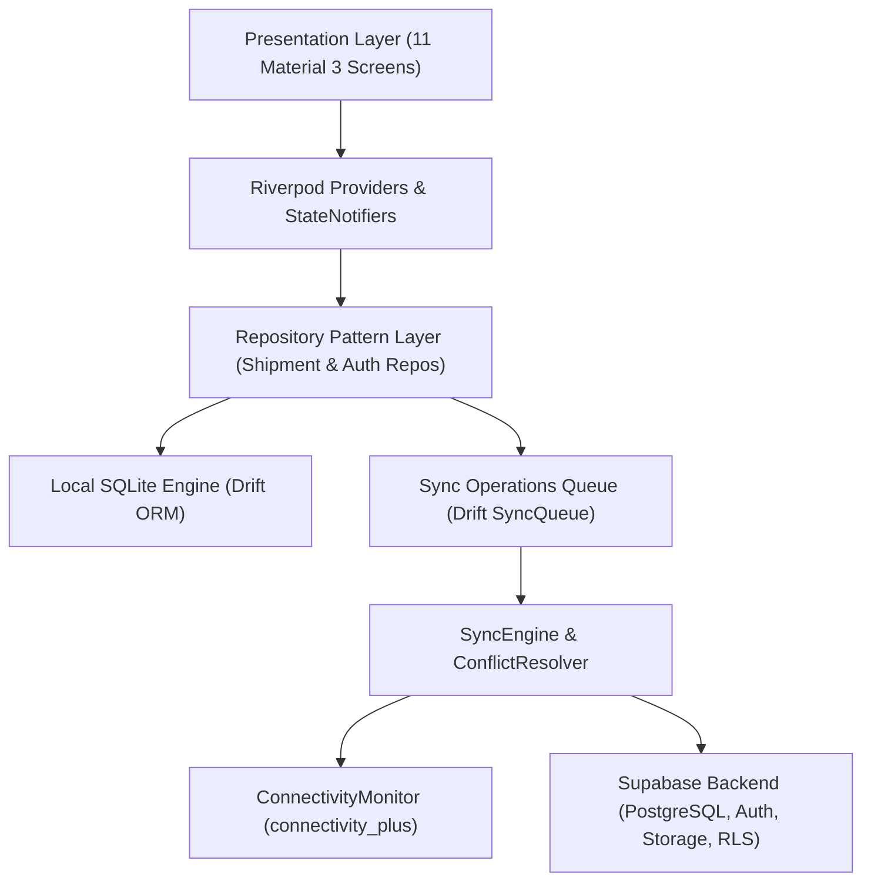
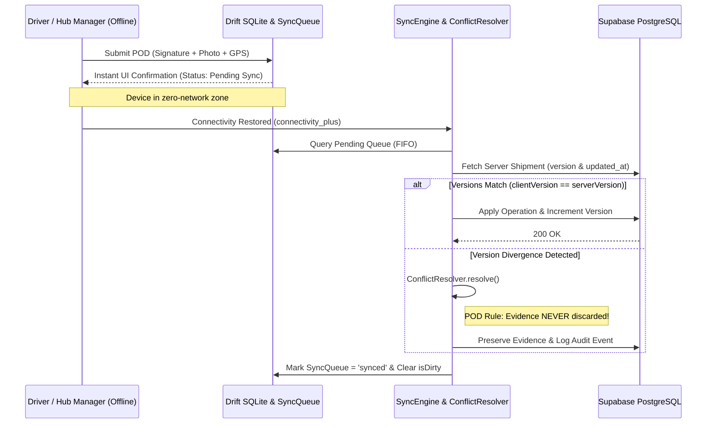

# LogiFlow — System Architecture & Technical Design

## 1. Feature-First Clean Architecture

The application follows a **Feature-First Clean Architecture** pattern combined with **Riverpod** reactive state management and **Drift (SQLite)** local persistence. Each domain module encapsulates its own `data`, `domain`, and `presentation` layers while sharing cross-cutting concerns through `core/` and `shared/`.

---

## 2. Offline-First Data Flow

Essential reads and writes NEVER block on network latency:

1. **Zero-Latency Reads**: All lists, dashboard metrics, and shipment timelines read directly from reactive Drift streams (`watchShipments()`). Even in airplane mode or warehouse basements in Noida Sector 62, the app displays full consignment history.
2. **Optimistic Local Writes**: Creating a shipment, updating transit status, or recording Proof of Delivery (POD) commits synchronously to SQLite with `isDirty = true` and `syncStatus = 'pending'`.
3. **FIFO Sync Queue**: Every offline mutation writes an atomic JSON operation payload into the `SyncQueue` table tagged with a UUID `operationId`, `userId`, `shipmentId`, `localTimestamp`, and `retryCount`.

---

## 3. Synchronization & Conflict Resolution Architecture

### Conflict Resolution Rules Implemented in [`ConflictResolver`](../lib/core/sync/conflict_resolver.dart):

1. **Proof of Delivery Evidence Preservation Rule (`SUBMIT_POD`)**:
   - **Never Overwrite Delivery Evidence**: If a driver submits a digital signature, photo, and GPS coordinates while offline and another hub manager updates the shipment status concurrently, the server version diverges.
   - `ConflictResolver` identifies `SyncOperationType.submitPOD`, preserves 100% of the physical evidence, transitions the shipment status to `delivered`, and writes an explicit audit event recording the version reconciliation.
2. **Delivered State Regression Guard**:
   - Once a shipment is marked `delivered` on the server, any delayed offline transit update (e.g., `in_transit`) received later is gracefully discarded (`ConflictStrategy.serverWins`) with an audit trail entry.
3. **Latest-Timestamp Precedence**:
   - For intermediate transit transitions (`picked_up`, `arrived_at_hub`, `out_for_delivery`), timestamp comparison resolves precedence cleanly without losing state consistency.

---

## 4. Security & Row Level Security (RLS)

All tables in `supabase/migrations/20261111000001_initial_schema.sql` enforce PostgreSQL **Row Level Security**:
- **Shippers**: Restricted to `SELECT` and `INSERT` on shipments where `sender_id = auth.uid()`. Cannot alter statuses or forge POD evidence.
- **Hub Managers & Drivers**: Authorized to update statuses, record hub arrivals, assign vehicles, and upload verified POD evidence (`submitted_by = auth.uid()`).
- **Zero Client Secrets**: Service-role keys are excluded from client builds; authentication runs over short-lived JWT sessions via Supabase Auth.
